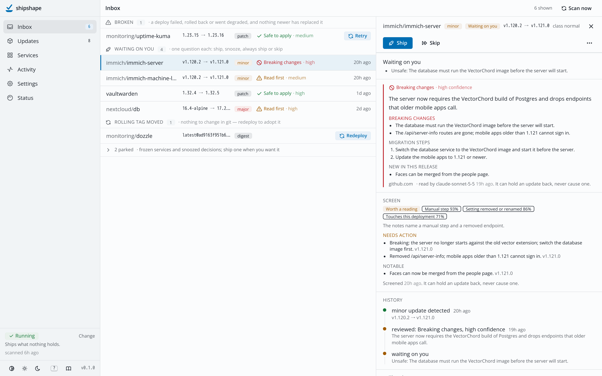

<p align="center">
  
</p>

<h1 align="center">shipshape</h1>

<p align="center">
  Docker image updates for a compose homelab kept in git.<br>
  Reads the changelog, ships what nothing holds, deploys it, and rolls it back if it broke.
</p>

<p align="center">
  <a href="https://justmytwospence.github.io/shipshape/">Documentation</a> ·
  <a href="https://justmytwospence.github.io/shipshape/start/quick-start/">Quick start</a> ·
  <a href="https://justmytwospence.github.io/shipshape/compare/">Compare</a> ·
  <a href="https://justmytwospence.github.io/shipshape/security/">Security model</a>
</p>

<picture>
  <source media="(prefers-color-scheme: dark)" srcset="docs/src/assets/screenshots/hero-decision-dark.png">
  
</picture>

shipshape watches the Docker Compose files in your git repository. When a registry has a
newer tag or a moved digest for a service you watch, it finds the upstream project, reads
the release notes for exactly the versions in between, and decides whether a person is
needed. If not, the change lands on your branch as a merge commit with the review in its
message, and shipshape deploys it with a real `docker compose up -d`, verifies it, soaks
it, and reverts it if it failed. If a person is needed, you get one card with four
answers: ship, snooze, always ship, skip.

## Why

Updaters that only notify leave every update to you. Updaters that recreate containers in
place move things without reading what changed and leave no record to revert. Renovate
opens good pull requests, but for most homelab images it has no release notes to show: it
finds them through an image label that many images lack or point at a packaging repository,
and it does not deploy. shipshape finds the notes through several sources, reads them, ships
through git, and watches the deploy.

## Quick start

```yaml
services:
  shipshape:
    image: ghcr.io/justmytwospence/shipshape:0.2
    restart: unless-stopped
    user: "${PUID}:${PGID}"            # the owner of your compose checkout
    group_add: ["${DOCKER_GID}"]       # the docker socket's group
    env_file: .env                     # REPO_DIR, GITHUB_REPO, GITHUB_TOKEN, SHIPSHAPE_PASSWORD
    volumes:
      - ${REPO_DIR}:${REPO_DIR}        # the same path inside and out
      - ./data:/data
      - /var/run/docker.sock:/var/run/docker.sock
    ports:
      - "8080:8080"
    stop_grace_period: 15s
```

The [quick start](https://justmytwospence.github.io/shipshape/start/quick-start/) has the
full file, the `.env` to go with it, and the first ten minutes. shipshape starts paused:
it shows you what it would do and ships nothing on its own until you switch Pause off.

## How it works

```
registry poll ──▶ new tag ──▶ find upstream ──▶ release notes ──▶ screen + reader
                                                                       │
                     ┌─────────────────────────────────────────────────┘
                     ▼
         any hold? ── no ──▶ cooldown ──▶ restore point ──▶ merge commit on your branch
             │                                                      │
             └─ yes ──▶ one card: ship · snooze · always ship · skip │
                                                                    ▼
                          fast-forward the checkout ──▶ docker compose up -d
                                                                    │
                                     verify ──▶ soak ──▶ verified   │
                                        └─ failed ──▶ git revert -m 1, redeploy, tell you
```

- **Holds, not risk scores.** A service has a class (`normal`, `stateful`, `ask`,
  `lifeline`, `frozen`, `skip`), and an update waits only for a concrete reason: listed
  work, an unsafe verdict, a one-way migration, missing notes where they matter, a missing
  restore point, or a drafted change nobody has read.
- **Release notes, found.** LinuxServer metadata, OCI labels, registry pages and GitHub,
  checked and ranked; two labels for what nothing finds. A cheap screen reads every
  update; Claude reads where a person will act. Without a model, updates still ship
  on the evidence that is left.
- **Git is the record.** One merge commit per change, built in shipshape's own clone.
  Settings, rules and labels you change in the UI are commits too.
- **Deploys you can trust to run unattended.** `docker compose up -d`, a health check, an
  HTTP probe, a crash watch, a soak, and one automatic revert inside the window.
- **Restore points** before stateful services move: their own dump command, or your
  offsite backup job.
- **One card per decision**, by webhook, ntfy, Discord, Gotify, Apprise or email. A
  phone-first web UI, and an MCP server for agents.
- **Security incidents** matched against package inventories of the images you run.

## What it needs, and what it does not do yet

- A git repository of compose files, checked out on the Docker host and pushed to an
  **https** remote (GitHub, Gitea, Forgejo, GitLab). No ssh remotes yet.
- One Docker host, linux/amd64 or linux/arm64, with the compose plugin.
- The Docker socket: deploying is the job. See the
  [security model](https://justmytwospence.github.io/shipshape/security/).
- For reading release notes, a Claude model through Anthropic or OpenRouter works best. Any
  Anthropic-compatible endpoint (Ollama, LiteLLM) works, as well as that model reads.
- Images in private registries are not watched, except on Docker Hub.
- It does not update itself, and it does not open pull requests.

## Documentation

Everything else is at **[justmytwospence.github.io/shipshape](https://justmytwospence.github.io/shipshape/)**:
[concepts](https://justmytwospence.github.io/shipshape/concepts/how-it-works/),
[guides](https://justmytwospence.github.io/shipshape/guides/sign-in/),
[environment variables](https://justmytwospence.github.io/shipshape/reference/environment/),
[labels](https://justmytwospence.github.io/shipshape/reference/labels/),
[policy file](https://justmytwospence.github.io/shipshape/reference/policy/) and
[troubleshooting](https://justmytwospence.github.io/shipshape/troubleshooting/).

## How this was built

shipshape is built by one person with AI coding agents. I decide what it does, direct the
work and review what lands; the agents write most of the code. What keeps that honest is
in the repository: over a thousand tests, a type checker over the code and the tests, CI
on every change, and the fact that it has run my own homelab every day since August 2026.

## License

shipshape is source-available under the
[Functional Source License 1.1, Apache-2.0 future license](LICENSE.md) (FSL-1.1-ALv2).
You may use, copy, modify and self-host it for any purpose, including at work, except
offering a commercial product or service that competes with it. Each release becomes
available under the Apache License 2.0 two years after it ships. The code as it stood before
the license change on 27 October 2026 (commit `4f52567`) was published under the MIT
license and remains available under it.

## Contributing

Bug reports and ideas are welcome as issues; please read
[CONTRIBUTING.md](CONTRIBUTING.md) before sending a pull request. Contributions are
licensed to the project under Apache-2.0 and signed off with `git commit -s`.
Security problems go to a [private advisory](https://github.com/justmytwospence/shipshape/security/advisories/new),
not an issue.
