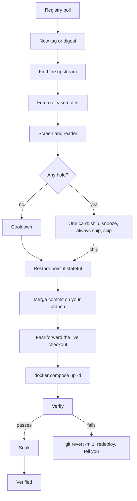

An update to one service travels one path, and every page of the interface and of this
manual names the same stage the same way.

## The loop

An update ships on its own unless a **hold** says a person is needed. There are only a few
holds, and each is concrete: see [Classes and holds](/shipshape/concepts/classes-and-holds/).
Nothing predicts how risky a version looks; verifying, soaking and rolling back carry that.

## Three git locations

Each has one strict role.

| Location | Role |
|---|---|
| The live checkout (`REPO_DIR`) | The only place deploys run. shipshape touches it solely to fetch, fast-forward and `compose up`. |
| shipshape's own clone (`DATA_DIR/repo`) | All branch, edit, merge and push work, so your uncommitted work in the checkout is never disturbed. |
| Your git host | Where your branch is published. Nothing else lives there: no branch of shipshape's is pushed, except a fork's. |

## Two layers of configuration

**Per-service data** lives as [labels](/shipshape/reference/labels/) on the service in its
compose file, so it travels with the thing it describes. shipshape reads them from the
**files**, never from running containers: a label you edit takes effect on the next scan with
nothing recreated, and a stale value cannot survive in a container that was cloned from
another.

**Policy** lives once, centrally, in the [policy file](/shipshape/reference/policy/): one
YAML file in your repository, which the Settings page edits (each save is a commit) and you
may edit by hand. Where it lives is `POLICY_FILE`, else `shipshape.yaml` at the root of the
repository.

## What runs when

- **The loop** ticks every 60 seconds while something is detected, shipping or deploying,
  and every 600 seconds when idle (`sync.poll_active_s`, `sync.poll_idle_s`). Each tick
  reviews what was detected, ships what is ready, deploys what shipped and keeps the
  checkout in step with your git host.
- **The scan** asks the registries what exists, at 03:00 in `TZ` by default
  (`scan.cron`). You can press **Scan now** at any time.
- **The security pass** reads the incident feed every 15 minutes when `security.mode` is
  not `off` (`security.interval_m`).
- **Retention** runs after every scan. It drops cached upstream responses not used for 30
  days, remembered tags for images no service runs, informational Activity lines older
  than 90 days (warnings and errors are kept), expired sign-in sessions and restore-point
  records whose file has been deleted.

shipshape starts **paused**. While Pause is on, it scans, reads release notes and shows what
it would do, but ships and deploys nothing on its own. A ship you press still deploys.
