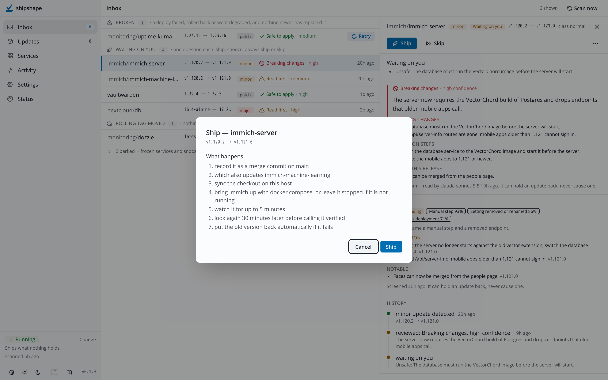

## Where updates show up

- **Inbox** is what needs you, grouped by why and worst first: **Broken**, **Waiting on you**,
  **Rolling tag moved**, then what **ships when you unpause**, then what happened recently.
  A new install sees a **Getting started** list here until a repository is read, a service
  is watched and a scan has run.
- **Updates** is every update by stage, filterable and searchable. Its **Releases** tab reads
  the same rows newest first, with the review's summary on the row.

An update is always at one of these stages: **Detected**, **Waiting on you**, **Waiting**,
**Shipping**, **Ready to deploy**, **Deploying**, **Verifying**, **Verified**, **Left
stopped**, **Failed**, **Rolled back**, **Skipped**, **Superseded** or **Frozen**.
**Waiting on you** is a decision. **Waiting** is an update that will ship on its own but not
yet, and its page says why: the cooldown, a review still coming, a snooze, or Pause.

## A decision

An update that something holds becomes one card. A decision is a stack: everything in it
that is waiting on you, answered with one tap and shipped as one merge commit and one deploy.

> **nextcloud: 2 updates**
> Ship these together? One merge commit, one deploy of nextcloud.
> - nextcloud 30.0.4 → 31.0.0: this service always asks
> - db 16 → 17: Unsafe: a major PostgreSQL upgrade needs a dump and restore

When one release fans out across several stacks that have nothing else waiting, it is one
card for the image instead of one per stack:

> **ghcr.io/example/sidecar v1.6.0 → v1.7.0 · 4 services**
> Ship? this service always asks
> Session ids are now encrypted; clients reconnect once.

The same card, with the same four answers, is on the update's page, in the
[MCP server](/shipshape/guides/mcp/), and, where you set it up, in your
[notifications](/shipshape/guides/notifications/).

## The four answers

- **Ship** ships it now, whatever is holding it: the cooldown and Pause do not apply to a
  ship you press. It asks first, and the confirmation says what will happen, written from
  your policy: how long it is watched and soaked, whether it is put back on failure, which
  other services it carries, and whether a restore point is taken first.
- **Snooze** puts it off for one week. The card comes back with its escalation clock
  restarted.
- **Always ship** does what Ship does, and also writes a [rule](/shipshape/concepts/classes-and-holds/#rules)
  to your policy file as a commit: the narrowest scope that explains the card, waiving only
  the reasons that were on it. It is never offered when any hold on the card cannot be
  waived, so a lifeline service, an unsafe verdict and a list of work to do always ask.
- **Skip** dismisses that version for good, and the drafted change that carried it. It asks
  first and says so.

## Waiting, not waiting on you

Several things make an update wait without asking you anything:

- **The cooldown.** A release must be seven days old (`ship.cooldown_days`) before it ships
  on its own.
- **Review pending.** A reading is still coming, for up to six hours.
- **A snooze.**
- **Pause.** shipshape starts paused, and **Ships when you unpause** lists exactly what
  switching Pause off would let through.

## After you press Ship

1. shipshape builds a branch in its own clone, merges it into your branch with a merge
   commit that carries the review, and pushes.
2. It fast-forwards your live checkout and runs `docker compose up -d`.
3. It verifies the deploy: health checks, an HTTP probe where a port is known, and a crash
   watch. A hard failure inside the window reverts the merge commit and redeploys, once.
4. It soaks: a second look half an hour later. Then the update reads **Verified**.

A service that was not running is not started: the change stands and the update reads **Left
stopped**. See [Deploy and rollback](/shipshape/concepts/deploy-and-rollback/).
